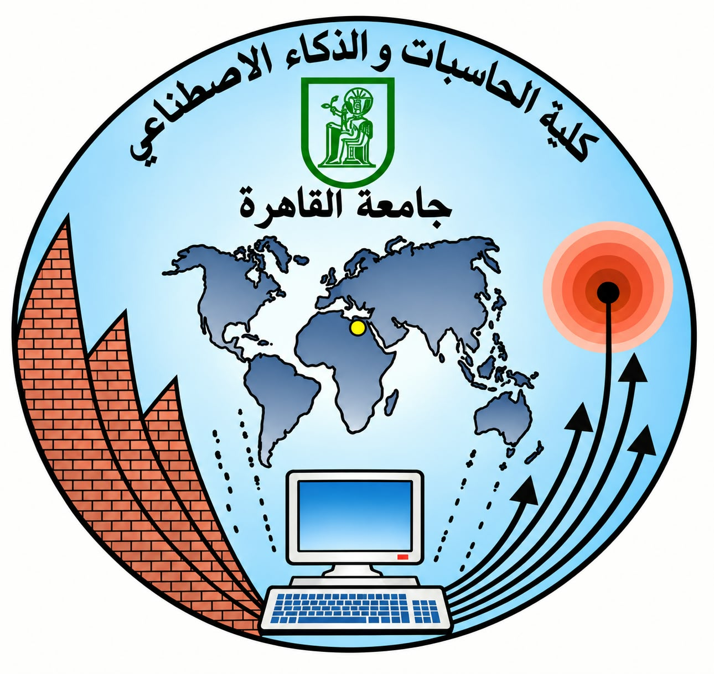

<!-- ===================== HEADER ===================== -->

  

  
  &nbsp;&nbsp;&nbsp;
  

  

  
  
  
  

---

## 👩‍💻 About Me

Software Engineering graduate from **Cairo University (Faculty of Computers & AI)**, passionate about building **reliable software** and proving it works.
I enjoy the full lifecycle: **designing**, **building**, **testing**, and **shipping** systems with containers.

- 🧪 **Testing & QA**: ISTQB-certified, with hands-on test automation (Postman, Selenium, Robot Framework, JUnit, jMock)
- 🔄 **Software Engineering Life Cycle**: requirements → design → implementation → testing → deployment
- 🌐 **Web & Backend**: Spring Boot, FastAPI, PHP, REST APIs, MySQL, microservices
- 🐳 **Containers & Cloud**: Docker, Podman, Docker Compose, Red Hat OpenShift
- 🎓 **Training**: Digital Egypt Pioneers (DEPI, Software Testing), NTI Full Stack (96%), Red Hat Academy
- 🌱 **Currently**: sharpening test automation and backend skills, and looking for a **remote internship in QA / Backend**

---

## 🛠️ Tech Stack

  

  
  
  
  
  
  

---

## 📌 Featured Projects

<table>
  <tr>
    <td width="50%" valign="top">
      <h3>🧠 <a href="https://github.com/AmiraEmad-04/EzzyHub">EzzyHub</a> Graduation Project · A+</h3>
      AI-assisted microservices platform that verifies source code against functional requirements.  
      • Owned the <b>Requirement Analyzer</b> (Spring Boot) and the <b>NLP service</b> (FastAPI) 
      • Hybrid matching (cosine + Jaccard): <b>92.5% precision</b>, ~66 ms per requirement 
      • <b>177 passing tests</b>, JWT auth, multi-LLM integration  
      
      
      
      
    </td>
    <td width="50%" valign="top">
      <h3>🏠 <a href="https://github.com/AmiraEmad-04/On-Demand-Home-Services-Marketplace-Platform">On-Demand Home Services Marketplace</a></h3>
      Distributed marketplace built with microservices: EJB (JBoss EAP), Spring Boot and RabbitMQ. Team project.  
      • I built the <b>User</b> and <b>Wallet</b> services 
      • Event-driven communication between services  
      
      
      
    </td>
  </tr>
  <tr>
    <td width="50%" valign="top">
      <h3>📅 <a href="https://github.com/AmiraEmad-04/EventPlanner_Backend">EventPlanner</a> <a href="https://github.com/AmiraEmad-04/EventPlanner_Frontend">Frontend</a></h3>
      Event management platform with organizer / attendee roles, full CRUD, and advanced search and filtering.  
      • <b>Containerized</b> and deployed the full stack on <b>Red Hat OpenShift</b> 
      • API verified with Postman  
      
      
      
    </td>
    <td width="50%" valign="top">
      <h3>🧪 <a href="https://github.com/AmiraEmad-04/fakestore-aliexpress-test-automation">FakeStore & AliExpress Test Automation</a></h3>
      Software testing course project: <b>Postman</b> API tests (valid + negative scenarios, 6 API bugs documented) and <b>Robot Framework + SeleniumLibrary</b> UI tests on AliExpress.  
      
      
      
    </td>
  </tr>
  <tr>
    <td width="50%" valign="top">
      <h3>✈️ <a href="https://github.com/AmiraEmad-04/Flight-Booking-Website">Flight Booking Website</a></h3>
      Full-stack flight booking system for passengers and airline companies. Team project.  
      • I built the <b>airline-company module</b> (dashboard, profile, flight management)  
      
      
      
    </td>
    <td width="50%" valign="top">
      <h3>♻️ <a href="https://github.com/AmiraEmad-04/Material-Stream-Identification-System">Material Stream Identification System</a></h3>
      Machine Learning course project: identifies the material of waste items from images to support smarter sorting and recycling.  
      
      
    </td>
  </tr>
</table>

  More:
  <a href="https://github.com/AmiraEmad-04/Grafana-and-Prometheus-Monitoring">📊 Monitoring Dashboard (Prometheus + Grafana)</a> ·
  <a href="https://github.com/AmiraEmad-04/Soft-Computing-Techniques">🧬 Soft Computing Techniques</a>
  

---

## 🎓 Certifications & Achievements

| | |
|---|---|
| 🏅 **ISTQB Certified Tester, Foundation Level (CTFL)** | 2025 |
| 🔴 **Red Hat AD183**: Application Development I (Java EE) | 2025 |
| 🔴 **Red Hat DO188**: OpenShift Dev I, Containers with Podman | 2026 |
| 🇪🇬 **DEPI**: Digital Egypt Pioneers, Software Testing track | 2024 – 2025 |
| 💻 **NTI × ITIDA**: Full Stack Web Development (PHP), scored 96% | 2025 |
| 🏆 **ICPC ECPC Qualifications**: Honorable Mention | 2025 |

---

## 📊 GitHub Stats

  
  

---

## 🐍 Contribution Snake

  <picture>
    <source media="(prefers-color-scheme: dark)" srcset="https://raw.githubusercontent.com/AmiraEmad-04/AmiraEmad-04/output/github-snake-dark.svg" />
    <source media="(prefers-color-scheme: light)" srcset="https://raw.githubusercontent.com/AmiraEmad-04/AmiraEmad-04/output/github-snake.svg" />
    
  </picture>

---

## 📫 Let's Connect

  
  
  

  <i>"Quality is not an act, it is a habit."</i> ✨

  

